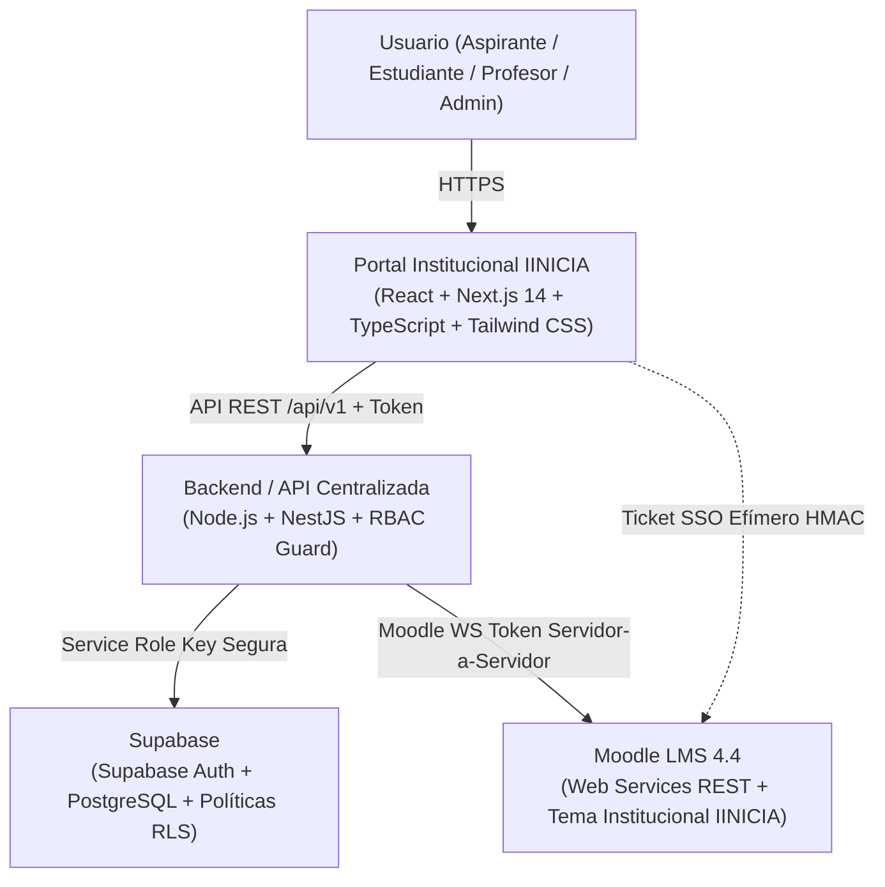

# Documentación de Arquitectura, Instalación, Administración y Operación — Portal IINICIA

Cumple con las **Secciones 4, 12, 14, 15, 18 y Criterios CA-18 y CA-20** del Documento de Alcance Técnico v1.0.

---

## 1. Arquitectura de Componentes



### Reglas Estrictas de Seguridad (CA-01, CA-06, CA-14, CA-15)
1. **Sin WordPress**: WordPress ha sido sustituido por completo por React/Next.js.
2. **Aislamiento de Credenciales**: Ni `SUPABASE_SERVICE_ROLE_KEY` ni `MOODLE_WS_TOKEN` se exponen jamás al navegador (`NEXT_PUBLIC_*` solo contiene variables públicas).
3. **Sin acceso directo a BD de Moodle**: El frontend nunca se conecta directamente a Moodle; toda sincronización y matrícula ocurre desde NestJS mediante Web Services oficiales (`core_user_*`, `enrol_manual_*`).
4. **Doble Validación RBAC + RLS**: Los permisos se validan tanto en el `RbacGuard` de NestJS como en las políticas Row Level Security (`001_initial_schema.sql`) de PostgreSQL en Supabase.

---

## 2. Manual de Instalación y Despliegue Reproducible (CA-18, CA-20)

### 2.1 Requisitos Previos
- Node.js `>= 20.x` y npm `>= 10.x`
- Git `>= 2.x`
- Docker y Docker Compose (para levantar Moodle 4.4 + MariaDB localmente)
- Proyecto en Supabase (o ejecución en modo réplica local incluido)

### 2.2 Pasos de Instalación
1. **Instalar dependencias del monorepo**:
   ```bash
   npm install
   ```
2. **Configurar variables de entorno**:
   Copiar `.env.example` a `.env` (y/o configurar variables por ambiente `DEV`, `STAGING`, `PRODUCTION`).
3. **Configurar Base de Datos en Supabase**:
   Ejecutar en el SQL Editor de Supabase:
   - `supabase/migrations/001_initial_schema.sql` (crea tablas, triggers y políticas RLS).
   - `supabase/seed.sql` (carga roles, programas académicos y mapeo de los 2 cursos obligatorios).
4. **Levantar y aprovisionar Moodle LMS**:
   ```bash
   npm run moodle:up
   npm run moodle:provision
   ```
   Para aplicar la identidad visual coherente con el portal (`CA-17`), pegar el contenido de `moodle/theme/iinicia_custom.scss` en *Administración del sitio > Apariencia > Temas > Boost > Configuración avanzada > Raw SCSS*.
5. **Compilar y ejecutar Backend y Frontend**:
   ```bash
   npm run build
   npm run dev:backend
   npm run dev:frontend
   ```
6. **Ejecutar la Prueba de Concepto Obligatoria (Sección 16 - 10 pasos)**:
   ```bash
   npm run test:poc
   ```

---

## 3. Manual de Administración, Profesor y Estudiante

### 3.1 Manual del Administrador (`admin@iinicia.edu.mx`)
1. Ingresar en `/login` y abrir `/admin` (**Panel Administrativo**).
2. En la tabla **Directorio de Usuarios**, filtrar por rol (`aspirante`, `estudiante`, `profesor`) o estado (`pendiente`, `activo`, `suspendido`).
3. Para autorizar a un Aspirante:
   - Cambiar su rol a `Estudiante` y su estado a `Autorizado / Activo`.
   - El backend NestJS ejecutará automáticamente `findOrCreateMoodleUser` verificando primero por correo en Moodle para evitar duplicados (`CA-10`) y almacenará `moodle_user_id`.
4. En **Autorizar Inscripción a Curso en Moodle**, seleccionar al usuario, el curso (`TI-101` o `WEB-202`) y el rol en Moodle (`Student` o `Teacher`) y pulsar **Autorizar y Sincronizar Matrícula en Moodle**.
5. Consultar la **Bitácora de Operaciones (`audit_logs`)** para auditar altas, cambios de rol y matrículas (`CA-19`).

### 3.2 Manual del Profesor (`profesor@iinicia.edu.mx`)
1. Iniciar sesión en `/login` y dirigirse a `/mi-iinicia`.
2. Visualizar únicamente los cursos donde tiene asignación docente (`editingteacher` / Teacher).
3. Hacer clic en **Acceder al Curso en Moodle (SSO)** para ingresar al aula virtual con permisos de edición, calificación de actividades y seguimiento de finalización.

### 3.3 Manual del Estudiante (`estudiante1@iinicia.edu.mx` / `estudiante2@iinicia.edu.mx`)
1. Registrarse en `/registro` o iniciar sesión en `/login`.
2. En `/mi-iinicia`, consultar su programa académico y únicamente los cursos en los que tiene matrícula activa (`CA-12`).
3. Hacer clic en **Acceder al Curso en Moodle (SSO)** para ingresar al curso con rol `Student`, consultar recursos PDF/páginas, participar en foros, entregar tareas y responder cuestionarios.

---

## 4. Inventario y Clasificación de Migración desde WordPress (Sección 12)

| Recurso / URL en WordPress | Clasificación | Ruta Destino en Next.js | Acción Aplicada |
| :--- | :--- | :--- | :--- |
| `/` (Inicio institucional) | **REESCRIBIR** | `/` | Rediseño completo en React/Next.js con identidad unificada |
| `/quienes-somos`, `/nosotros` | **ACTUALIZAR** | `/universidad` | Redirección 301 configurada en `next.config.mjs` |
| `/programas`, `/cursos` | **MIGRAR / ACTUALIZAR** | `/oferta-academica` | Catálogo dinámico + Redirección 301 |
| `/inscripciones` | **REESCRIBIR** | `/admisiones` y `/registro` | Integrado con Supabase Auth + Redirección 301 |
| `/mi-cuenta` | **REESCRIBIR** | `/mi-iinicia` | Panel personalizado por rol + Redirección 301 |
| `/wp-login.php`, `/wp-admin` | **ELIMINAR** | `/login` | WordPress retirado; redirección 301 de seguridad hacia `/login` |
| Plugins, shortcodes y constructores visuales | **ELIMINAR** | N/A | Eliminados al 100% conforme a Sección 12 y `CA-01` |

---

## 5. Plan de Respaldo y Recuperación (Secciones 12, 14 y 18)

1. **Respaldo previo al corte de WordPress**:
   - Exportación íntegra de archivos (`wp-content/uploads`) y dump SQL de la base de datos heredada almacenados en bóveda fría de solo lectura antes del cambio de DNS.
2. **Respaldo de Supabase (PostgreSQL + Auth)**:
   - Esquema y políticas versionadas en Git (`supabase/migrations/001_initial_schema.sql` y `supabase/seed.sql`).
   - Backups automáticos diarios de PostgreSQL y Point-in-Time Recovery (PITR) en producción.
3. **Respaldo de Moodle LMS**:
   - Respaldo diario automatizado del volumen `moodle_db_data` (`mysqldump`) y del directorio `moodledata_data`, además de copias `.mbz` de los cursos `IINICIA-TI-101` e `IINICIA-REACT-202`.
